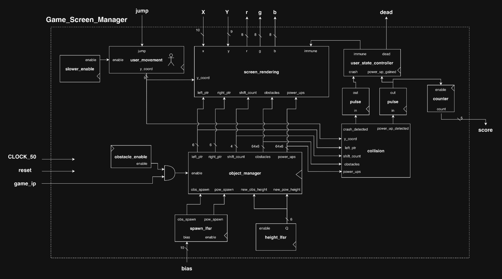
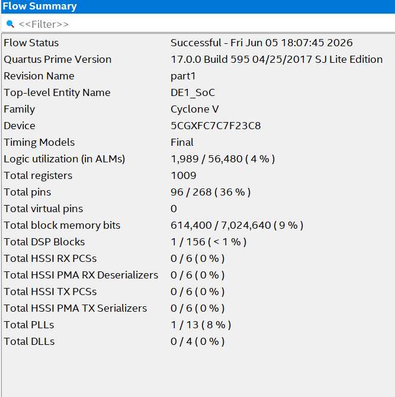

# Rhythm-Rush:Side-Scrolling VGA Game (FPGA / SystemVerilog)

A side-scrolling jump-and-dodge game written in SystemVerilog and rendered over VGA. The player is a ball on the left side of the screen. It jumps with simple physics to avoid obstacles scrolling in from the right and to collect power-ups. Score is shown on the HEX displays.

[Demo video](https://drive.google.com/file/d/18Wh37iLt6umY-Fe4sftWXFF38GNu7u4O/view?usp=sharing)

## Top-Level Block Diagram

This is my top level block diagram for my side scrolling game. It takes Clock_50, key 0 (jump), key 3 (start), switches 8-0 (difficulty selection), and switch 9 (reset) as inputs. It renders the game on the VGA display and outputs your score on hex displays 0 and 1. The majority of the game logic is in the game_screen_manager module. This top level first processes user input by synchronizing it to avoid metastability and edge detecting button presses. It uses the screen_controller FSM to select which screen to display. The screen_controller takes in start and dead and decides if it should route the start screen, game screen, or end screen to the video_driver. The screen_controller also has a game in progress signal to pause object spawning and movement. TLDR: Top level processes user input and muxes between different screens based on screen_controller.

## Screen_Controller ASMD

This is my ASMD for the screen_controller in the top level module. Based on start (an external input) and dead (an intermediate signal when a player collides with an obstacle) it moves through the game states. Based on the game state, a particular screen_manager's r,g,b values are routed to the video_driver for a given x,y pixel. The start screen and end screen are stored in ROM but the game screen is more complex, using multiple smaller modules to figure out what should be rendered. TLDR: Decides which screen the top level should display.

## Game_Screen_Manager Block Diagram

This is where the meat of the game logic takes place. It takes clock, player jump, game in progress, difficulty bias, and an x, y pixel coordinate as inputs. It outputs the current score, if the player dies, and the r,g,b values for a given x,y. User_movement takes the jump signal and updates the player's position (jumping up and gradually falling down) by updating the player's y coordinate. It uses a slower enable to move at an easier speed to play. The object_manager is a circular buffer that stores obstacles and power ups. It uses LFSRs to generate random heights for objects and randomly decide if an object should be spawned. Objects are only rotated if the game is in progress. Collision is a combinational module that detects if the player has collided with an obstacle or power up. Crash detection and power_up_detection are pulsed before being passed to the user_state_controller to ensure they are only high for one cycle. The user_state_controller outputs if a player is immune from picking up a power up or if the player has died. Screen_rendering is combinational and takes the outputs of all of these modules to render a game screen. When the player is immune, it turns purple. The score is based on how many power ups are collected. TLDR: Given an x,y coordinate this outputs the r,g,b value for it based on player and object positions.

## User_State_Controller ASM

This is my user_state ASM. The player starts as alive, when it crashes, it dies. However, if the player picks up a power up, it becomes immune until the next time it crashes. Immune is outputted to change the player's color. Dead is outputted to end the game and display the game over screen.

---

# Results

## ModelSim for Screen Controller

This tests every transition for the screen controller. It correctly resets to the Start screen and moves to Game after start is hit. It remains in the Game state until the dead signal is received and it transitions to the End screen.

## ModelSim for User State Controller

This tests every transition for the user state controller. It correctly resets to the Alive state. It moves to Immune when a power up is gained and outputs the immune signal. When a crash is detected, it moves back to the Alive state. When a crash is detected in the Alive state it moves to the Dead state and outputs dead.

## ModelSim for Collision Detection

This checks several cases for obstacle and power up collisions. First, I test a left chunk obstacle collision. So the obstacle is in column 8 and there is no fine grained shift. The obstacle top is at 300-20 = 280 and the player spans 260-290. These overlap so there is a collision detected. I check left, right, and middle column collisions for obstacles and power ups. I also check the case when the fine grained shift is not zero.

## ModelSim for User Movement

User Movement tracks the user's top left coordinate, called y_coord. The position is calculated by y_d = y_q + vy_d. When up/jump is hit, the user's vy (velocity) becomes -12. This makes it update by moving up quickly. Each time it moves up, vy is decremented. This makes the jump slow down towards the top of the arch. Vy eventually becomes zero and then positive as the user falls down. As vy becomes more positive, it falls faster.

The user continues to fall until y_coord is back to 280. Vy gets set back to zero, so that the user doesn't keep moving.

If you press up while the user is already jumping, it does not affect the user's position at all.

## ModelSim for Object Manager

My object manager is a circular buffer. It handles updating left and right pointers and writing new objects to the busses. You can see the pointers initialize to 0 and 63. The fine grained shift count goes to 9 before the pointers increment. I start by writing an object of height 12 to the obstacle bus. You can see it gets added to the right pointer's slot, 0. It only gets written because obs_spawn is high.

This shows writing 9 and 5 to the power_ups bus when pow_spawn is high and 20 to obstacles when obs_spawn is high.

When pow_spawn and obs_spawn are low, 31 does not get written to the buses.

When the queue wraps back around, if obs_spawn or pow_spawn is low, the slot is filled with zero instead of the old height persisting. This ensures that the game field isn't too repetitive and doesn't get cluttered with too many objects.

---

## VGA Game Screenshots

Displaying the start screen from memory.

Game view

Player jumping

Player colliding with a power up and turning purple.

Game over screen from ROM.

---

## Brief Overview

I spent the most time trying to figure out how to rotate objects around the screen. This was something I was unsure of when I submitted my proposal. I implemented my own custom memory module to handle it.

### Mock Game Screen Render

This is what the game screen looks like. The user is on the left as a ball. It jumps up and falls in accordance with physics. Objects scroll in from the right. The screen is 640 pixels divided into chunks of size 10. So I am tracking 64 obstacles or power up locations. Obstacles always have width 10 but handle heights (height = 0 when there is no object). Power ups are always size 10 by 10, but are at a random displacement from the ceiling.

### Object Manager Overview

My object manager handles the rotation of objects. Objects are stored in 64 x 6 multidimensional buses. There are 64 slots and they have heights of up to 2^6. New objects are written to the right pointer's location and the pointers are used to know where on the screen objects should be placed. I just need to store heights and update pointers.

Since each object has a width of 10, I also need a fine grained shift to rotate the objects 1 pixel at a time before the left/right pointers are updated.

### Collision Overview

My collision detection is more complicated than I expected and was actually the source of a few bugs. The player can spawn at most 3 different objects depending on left and right pointers and shift count. Although the character is rendered as a circle, it is treated as being in a square boundary box. Originally I had errors because I was only checking the left and right edge and thought that the player only overlapped with two objects at a time.

---

## Flow Summary from Compilation Report

---

## Experience Report

**Give any positive or negative feedback you have on the lab. What was your implementation experience like?**

So much fun! I really enjoyed having a more open ended project to show off what I learned in the class.

**Describe any significant issues you encountered while completing the lab and how you overcame them (or "I did not encounter any significant issues in this lab").**

I did not encounter any significant issues in this lab.

**Include any tips and/or tricks that you discovered while completing the lab – these tips may prove useful to you in future labs!**

None.

**Your lab report should end with your estimated total time (in hours) to complete the lab. This includes reading, planning, design, coding, debugging, testing, etc.**

60+ hrs.

---

## Video Link

[https://drive.google.com/file/d/18Wh37iLt6umY-Fe4sftWXFF38GNu7u4O/view?usp=sharing](https://drive.google.com/file/d/18Wh37iLt6umY-Fe4sftWXFF38GNu7u4O/view?usp=sharing)
