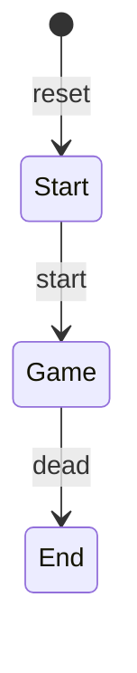
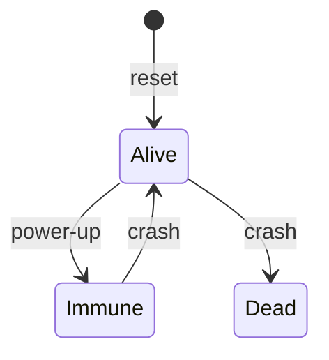

# Rhythm-Rush:Side-Scrolling VGA Game (FPGA / SystemVerilog)

A side-scrolling jump-and-dodge game written in SystemVerilog and rendered over VGA. The player is a ball on the left side of the screen. It jumps with simple physics to avoid obstacles scrolling in from the right and to collect power-ups. Score is shown on the HEX displays.

[Demo video](https://drive.google.com/file/d/18Wh37iLt6umY-Fe4sftWXFF38GNu7u4O/view?usp=sharing)

---

## Table of Contents
- [Features](#features)
- [Inputs and Outputs](#inputs-and-outputs)
- [Design Procedure](#design-procedure)
  - [Top-Level Block Diagram](#top-level-block-diagram)
  - [Screen Controller ASMD](#screen-controller-asmd)
  - [Game Screen Manager](#game-screen-manager)
  - [User State Controller ASM](#user-state-controller-asm)
- [Implementation Details](#implementation-details)
  - [Object Manager](#object-manager)
  - [Collision Detection](#collision-detection)
  - [User Movement](#user-movement)
- [Results](#results)
  - [ModelSim Simulations](#modelsim-simulations)
  - [VGA Screenshots](#vga-screenshots)
  - [Compilation Report](#compilation-report)
- [Experience Report](#experience-report)

---

## Features
- Three screens: start (ROM), game, and game over (ROM).
- Physics-based jump: the ball rises quickly, slows near the apex, then accelerates downward.
- Randomly generated obstacles and power-ups, using LFSRs for spawn decisions and heights.
- Power-ups make the player immune to the next crash, and the ball turns purple.
- Score is the number of power-ups collected, shown on HEX0 and HEX1.
- Difficulty selection via switches.

## Inputs and Outputs

| Signal | Direction | Description |
|---|---|---|
| `Clock_50` | Input | 50 MHz board clock |
| `KEY[0]` | Input | Jump |
| `KEY[3]` | Input | Start |
| `SW[8:0]` | Input | Difficulty selection |
| `SW[9]` | Input | Reset |
| VGA (R, G, B, sync) | Output | Game display |
| `HEX0`, `HEX1` | Output | Score |

---

## Design Procedure

### Top-Level Block Diagram

The top level processes user input and muxes between screens based on `screen_controller`. Most of the game logic lives in `game_screen_manager`.

1. **Input conditioning:** Inputs are synchronized to avoid metastability, and button presses are edge-detected.
2. **Screen selection:** The `screen_controller` FSM takes `start` and `dead` and decides whether to route the start, game, or end screen to the `video_driver`.
3. **Game pause:** The `screen_controller` also outputs a *game in progress* signal that pauses object spawning and movement when the game is not running.

**TL;DR:** The top level processes user input and muxes between screens based on `screen_controller`.

### Screen Controller ASMD

Based on `start` (an external input) and `dead` (an internal signal asserted when the player hits an obstacle), the FSM moves through the game states. The current state determines which screen manager's `r, g, b` values are routed to the `video_driver` for a given `x, y` pixel.

- The start and end screens are stored in ROM.
- The game screen is more complex and uses several smaller modules to decide what to render.

**TL;DR:** Decides which screen the top level should display.

### Game Screen Manager

This module holds most of the game logic.

- **Inputs:** clock, player jump, game in progress, difficulty bias, and the `x, y` pixel coordinate.
- **Outputs:** current score, player dead flag, and `r, g, b` for the given `x, y`.

| Submodule | Role |
|---|---|
| `user_movement` | Takes the jump signal and updates the player's `y` coordinate (jump up, gradually fall). A slower enable keeps the speed playable. |
| `object_manager` | Circular buffer storing obstacles and power-ups. LFSRs generate random heights and decide randomly whether to spawn an object. Objects only rotate while the game is in progress. |
| `collision` | Combinational. Detects player collisions with obstacles or power-ups. |
| Pulse logic | Crash and power-up detections are pulsed so they are high for exactly one cycle before reaching the state controller. |
| `user_state_controller` | Outputs whether the player is immune (from a power-up) or dead. |
| `screen_rendering` | Combinational. Takes all of the above and produces `r, g, b`. The player turns purple when immune. |

Score is based on how many power-ups are collected.

**TL;DR:** Given an `x, y` coordinate, this outputs the `r, g, b` value based on player and object positions.

### User State Controller ASM

The player starts alive. A crash while alive means death. Picking up a power-up grants immunity until the next crash, which returns the player to alive. `immune` changes the player's color, and `dead` ends the game and shows the game over screen.

---

## Implementation Details

### Object Manager

The hardest part of the project was working out how to rotate objects around the screen. I was unsure about this when I submitted my proposal, and I implemented a custom memory module to handle it.

- The screen is 640 pixels wide, divided into chunks of 10 pixels, so 64 obstacle or power-up slots are tracked.
- Objects are stored in 64 x 6 buses (64 slots, heights up to 2^6).
- Obstacles are always 10 pixels wide, and a height of 0 means no object.
- Power-ups are always 10 x 10, at a random displacement from the ceiling.
- New objects are written to the **right pointer's** slot. The pointers tell the renderer where objects belong on screen, so only heights and pointers need to be stored.
- Since each object is 10 pixels wide, a **fine-grained shift counter** moves objects 1 pixel at a time. The pointers only increment after the counter reaches 9.
- When the queue wraps around and `obs_spawn` or `pow_spawn` is low, the slot is cleared to zero instead of keeping its old height. This keeps the field from becoming repetitive or cluttered.

### Collision Detection

The collision logic was more complicated than expected and caused several bugs. Although the player is drawn as a circle, it is treated as a square bounding box. The player can overlap up to **three** different objects, depending on the left and right pointers and the shift count. Originally I only checked the left and right edges and assumed the player overlapped just two objects, which caused errors.

### User Movement

`user_movement` tracks the player's top-left `y_coord` using `y_d = y_q + vy_d`.

- On jump, `vy` is set to **-12**, so the player moves up quickly.
- Each update, `vy` is incremented toward zero, so the jump slows near the top of the arc. It then becomes positive and the player falls faster and faster.
- When `y_coord` returns to the ground at **280**, `vy` is reset to 0 so the player stops.
- Pressing jump while already airborne has no effect.

---

## Results

### ModelSim Simulations

**Screen Controller**

Every transition is tested. The controller resets to Start, moves to Game when start is pressed, stays in Game until `dead`, then goes to End.

**User State Controller**

Every transition is tested.
- Resets to Alive.
- Moves to Immune on a power-up and asserts `immune`.
- A crash while Immune returns to Alive.
- A crash while Alive moves to Dead and asserts `dead`.

**Collision Detection**

Several obstacle and power-up cases are covered, including left, middle, and right column collisions, and cases where the fine-grained shift is non-zero. For example, in the left-chunk obstacle test the obstacle is in column 8 with no shift. Its top is at 300 - 20 = 280 and the player spans 260-290. These overlap, so a collision is detected.

**User Movement**

Shows the jump arc: `vy` starts at -12, rises toward 0, goes positive on the way down, and resets at `y_coord = 280`. A second jump press mid-air does not change the position.

**Object Manager**

- The pointers initialize to 0 and 63.
- The fine-grained shift count goes to 9 before the pointers increment.
- An obstacle of height 12 is written to the right pointer's slot (0), and only because `obs_spawn` is high.
- Values 9 and 5 are written to the power-up bus when `pow_spawn` is high, and 20 to the obstacle bus when `obs_spawn` is high.
- When both spawn signals are low, the value 31 is not written to either bus.
- When the queue wraps with a spawn signal low, the slot is zeroed rather than keeping the old height.

### VGA Screenshots

| Start screen (from ROM) | Gameplay |
|---|---|
|  |  |

| Player jumping | Power-up collected (immune) |
|---|---|
|  |  |

| Game over screen (from ROM) |
|---|
|  |

### Compilation Report

---

## Experience Report

- **Feedback:** This was a lot of fun. The open-ended project let me show off what I learned in the class.
- **Significant issues:** None.
- **Tips and tricks:** None.
- **Total time:** 60+ hours.

---

## Demo

[Watch the demo video](https://drive.google.com/file/d/18Wh37iLt6umY-Fe4sftWXFF38GNu7u4O/view?usp=sharing)
